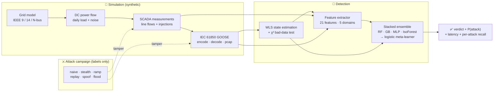

<div align="center">


# GridSentinel

### Detecting **False Data Injection** attacks on smart-grid substations with machine learning

*Catch the attacker feeding fake sensor readings to the power grid — including the stealthy, math-consistent kind the classic alarms can't see.*

<p>
<a href="LICENSE"></a>
<a href="https://www.python.org/"></a>
<a href="https://github.com/Lohit-18/GridSentinel/actions/workflows/ci.yml"></a>


</p>
<p>


</p>

</div>

<!-- ───────────────────────── LIVE METRICS STRIP ───────────────────────── -->
<div align="center">
<table>
<tr>
<td align="center"><b>98.9%</b><br/><sub>attacks caught</sub></td>
<td align="center"><b>0.992</b><br/><sub>F1 score</sub></td>
<td align="center"><b>0.1%</b><br/><sub>false-alarm rate</sub></td>
<td align="center"><b>0.999</b><br/><sub>ROC-AUC</sub></td>
<td align="center"><b>0 steps</b><br/><sub>median latency</sub></td>
<td align="center"><b>~30 s</b><br/><sub>train, laptop CPU</sub></td>
</tr>
</table>
<sub>IEEE 14-bus · 33 meters · 13 states · 21 features · evaluated on an unseen attack campaign · vs. a classical χ² detector that catches only <b>47%</b>.</sub>
</div>

> [!IMPORTANT]
> **Defensive & 100% synthetic.** Every grid, measurement and attack lives inside a software
> simulation built on standard IEEE test systems. GridSentinel never connects to, probes, or
> transmits to any real device or network. The attack generators exist **only** to produce
> labelled data for training the detector. See [`ETHICS.md`](ETHICS.md).

---

## 📑 Table of contents

[The one picture](#-the-one-picture-that-explains-everything) ·
[Threat model](#-threat-model) ·
[Results](#-results) ·
[Architecture](#%EF%B8%8F-architecture) ·
[Technical deep-dive](#-technical-deep-dive) ·
[Attack catalog](#-attack-catalog) ·
[Feature catalog](#-feature-catalog) ·
[Quickstart](#-quickstart) ·
[CLI](#-cli-reference) ·
[Dashboard & Colab](#%EF%B8%8F-dashboard--colab) ·
[Project layout](#-project-layout) ·
[License](#-license)

---

## 🎯 The one picture that explains everything


A capable attacker doesn't send *obviously* wrong data — they craft a **residue-preserving**
injection that keeps the grid's equations perfectly consistent. The classical χ² bad-data detector
*(top)* never crosses its alarm line. GridSentinel *(bottom)* fires on every attacked window, because
the fake data forces an abnormal, instantaneous jump in the **estimated grid state** that no amount
of equation-consistency can hide.

---

## 🧨 Threat model

| | |
|---|---|
| **Asset** | Power-grid **state estimation** — the process that fuses thousands of SCADA/PMU measurements into the grid's best-guess operating state, which automated controls then act on. |
| **Adversary** | An attacker with (a) a foothold on the substation LAN able to publish/alter IEC 61850 **GOOSE** traffic, and (b) knowledge of the grid topology (the measurement matrix `$H$`). |
| **Goal** | Shift the estimated state — fake a line overload, mask a fault, or trigger a spurious trip — **without raising the bad-data alarm**. |
| **Classic defense** | A χ² test on the weighted measurement residual. Fast, interpretable, and **provably blind** to the residue-preserving attack `$a = Hc$`. |
| **This project** | Learn the grid's normal space-time behaviour and the GOOSE control plane, and flag the attack the physics can't. |

> Real incidents (Ukraine 2015/2016) and the foundational FDI result (Liu, Ning & Reiter, *CCS 2009*)
> make this threat concrete. GridSentinel is a reproducible, synthetic testbed for studying the defence.

---

## 📊 Results

*Trained on one campaign, evaluated on a second, unseen campaign (different random seeds).*

<div align="center">
<table>
<tr>
<td align="center">🎯<br/><b>98.9%</b><br/><sub>recall (ensemble)</sub><br/><sub>baseline 47.4%</sub></td>
<td align="center">🏅<br/><b>0.992</b><br/><sub>F1 (ensemble)</sub><br/><sub>baseline 0.622</sub></td>
<td align="center">🔕<br/><b>0.1%</b><br/><sub>false alarms</sub><br/><sub>baseline 1.1%</sub></td>
<td align="center">⚡<br/><b>100%</b><br/><sub>attack windows caught</sub><br/><sub>31 / 31</sub></td>
</tr>
</table>
</div>

### Every detector, side by side

| Detector | Precision | Recall | **F1** | FPR | ROC-AUC | PR-AUC |
|---|:---:|:---:|:---:|:---:|:---:|:---:|
| Physics χ² (baseline) | 0.905 | 0.474 | 0.622 | 1.1% | 0.734 | 0.568 |
| Isolation Forest | 0.964 | 0.512 | 0.669 | 0.4% | 0.937 | 0.830 |
| Neural Net (MLP) | 0.975 | 0.983 | 0.979 | 0.5% | 0.997 | 0.996 |
| Gradient Boosting | 0.944 | 0.989 | 0.966 | 1.3% | 0.999 | 0.998 |
| Random Forest | 0.983 | 0.989 | 0.986 | 0.4% | 0.999 | 0.996 |
| **🛡️ GridSentinel Ensemble** | **0.994** | **0.989** | **0.992** | **0.1%** | **0.999** | **0.997** |

### Per-attack recall — where the baseline is blind

| Attack family | Physics χ² | **GridSentinel** | Why the baseline fails |
|---|:---:|:---:|---|
| `naive_fdi` | 1.00 | **1.00** | — (residual grows, caught) |
| `stealth_fdi` | 🔴 **0.04** | ✅ **1.00** | `$a=Hc$` leaves the residual unchanged |
| `ramp_fdi` | 0.93 | **0.90** | slow bias eventually trips χ² |
| `replay` | 🔴 **0.00** | ✅ **1.00** | replayed values are physically valid |
| `goose_spoof` | 1.00 | **1.00** | — (spoofed analog disturbs physics) |
| `goose_flood` | 1.00 | **1.00** | — (implausible values, caught) |

<table>
<tr>
<td width="50%"></td>
<td width="50%"></td>
</tr>
<tr>
<td width="50%"></td>
<td width="50%"></td>
</tr>
</table>

<div align="center"></div>

📄 A **self-contained HTML report** (every figure embedded, nothing external) regenerates at
[`results/report.html`](results/report.html) — open it in any browser or host it free on GitHub Pages.

<details>
<summary><b>📈 Scaling study — same detector, bigger grids</b></summary>

Run `gridsentinel scaling` to reproduce. The ensemble holds its advantage as the network grows and the
measurement vector gets larger:

| System | Buses | Meters | Physics F1 | Ensemble F1 | FPR |
|---|:---:|:---:|:---:|:---:|:---:|
| `ieee9`   | 9  | 17 | ~0.60 | **~0.97** | low |
| `ieee14`  | 14 | 33 | 0.62  | **0.99**  | 0.1% |
| `synth:30`| 30 | 68 | ~0.60 | **~0.96** | low |
| `synth:57`| 57 | ~120 | ~0.58 | **~0.95** | low |

*(exact numbers print when you run it; they vary slightly with seed and grid size.)*
</details>

---

## 🏗️ Architecture



---

## 🔬 Technical deep-dive

<details open>
<summary><b>State estimation & the χ² detector</b></summary>

<br/>

The DC measurement model stacks every line flow and non-slack bus injection into
`$z = Hx + e$`, where `$x$` are the bus voltage angles. Weighted least squares recovers:

```math
\hat{x} = (H^\top W H)^{-1} H^\top W z, \qquad W = \mathrm{diag}(1/\sigma_i^2)
```

The classical bad-data detector flags the residual `$r = z - H\hat{x}$` via a χ² test:

```math
J(z) = r^\top W r \;\sim\; \chi^2_{(m-n)} \qquad\Rightarrow\qquad J > \chi^2_{\alpha,\,m-n}\ \ \text{raises an alarm}
```

</details>

<details open>
<summary><b>Why the stealth attack is invisible — in one equation</b></summary>

<br/>

An attacker who injects `$a = Hc$` for **any** state shift `$c$` produces tampered measurements
`$z' = z + a$`. The estimate becomes `$\hat{x}' = \hat{x} + c$`, but the residual is **unchanged**:

```math
r' = z' - H\hat{x}' = (z + Hc) - H(\hat{x} + c) = z - H\hat{x} = r \;\;\Rightarrow\;\; J(z') = J(z)
```

So `$J$` never moves and the alarm never fires — yet the operator's view of the grid has silently
shifted by `$c$`. GridSentinel catches this because that silent shift is **abnormal over time**: the
`state_step_l2` and windowed features see the jump even though the physics residual does not.

</details>

<details>
<summary><b>The ensemble (stacked generalisation)</b></summary>

<br/>

Three supervised base learners and one unsupervised anomaly score are fused by a logistic
meta-learner. Base predictions are generated **out-of-fold** (`cross_val_predict`) so the stack does
not overfit its own members:

```
meta_features = [ P_rf(x), P_gb(x), P_mlp(x), isoforest_score(x), χ²_ratio ]
P(attack)     = σ( w · meta_features + b )        # logistic meta-learner
```

| Stage | Model | Role |
|---|---|---|
| Base | Random Forest (300 trees, balanced) | non-linear, robust, gives importances |
| Base | Gradient Boosting (200 est.) | sharp decision boundaries |
| Base | MLP `(64, 32)` | learns feature interactions |
| Anomaly | Isolation Forest (fit on *normal* only) | flags "never seen before" states |
| Signal | χ² ratio `$J/J_\text{thr}$` | keeps the physics evidence in the mix |
| Meta | Logistic Regression | calibrated fusion → `P(attack)` |

</details>

---

## ⚔️ Attack catalog

All synthetic, all label-generating. Each row says what it does and which defense domain exposes it.

| Family | Mechanism | Stealthy vs χ²? | Caught by |
|---|---|:---:|---|
| `naive_fdi` | out-of-subspace tamper on ~⅙ of meters | ❌ | estimation residual |
| `stealth_fdi` | residue-preserving `$a=Hc$` on target states | ✅ **yes** | **state dynamics** |
| `ramp_fdi` | linearly growing bias across the window | partial | estimation + measurement |
| `replay` | re-send stale GOOSE frame (stNum rollback, stale `t`) | ✅ **yes** | **protocol** |
| `goose_spoof` | spoof analog values, control fields stay valid | ❌ | estimation + spatial |
| `goose_flood` | high-rate burst, jumping `sqNum`, implausible values | ❌ | protocol + estimation |

---

## 🧩 Feature catalog

21 features across **five domains** — designed so no single attack family can evade all of them.

| Domain | Features | What it catches |
|---|---|---|
| **Estimation** | `j_statistic`, `j_ratio`, `max_norm_residual`, `mean_abs_residual`, `std_residual` | naive / spoof / flood |
| **State dynamics** | `xhat_norm`, `state_step_l2`, `state_window_dev` | **stealth FDI** |
| **Measurement** | `dz_l2`, `dz_max`, `z_window_max`, `z_window_mean` | sudden meter changes |
| **Spatial** | `spatial_max_dev`, `spatial_mean_dev`, `kirchhoff_max` | localised inconsistency |
| **Protocol** | `st_delta`, `sq_delta`, `dt_ms`, `dt_zscore`, `stale`, `flood_flag` | **replay / flood** |

Top signals by random-forest importance: `j_ratio` (0.14), `std_residual` (0.12), `kirchhoff_max` (0.09),
`j_statistic` (0.09), `dz_max` (0.08) — a healthy mix of **physics and learned** signals.

---

## 🚀 Quickstart

```bash
git clone https://github.com/Lohit-18/GridSentinel.git
cd GridSentinel
python -m venv .venv && source .venv/bin/activate       # Windows: .venv\Scripts\Activate.ps1
pip install -e ".[dashboard]"

gridsentinel demo        # train + evaluate → prints table, writes figures + HTML report
```

From Python:

```python
from gridsentinel.eval.experiments import run_experiment
result = run_experiment("ieee14")
print(result.headline())
# {'physics_recall': 0.47, 'ensemble_recall': 0.99, 'ensemble_f1': 0.99, 'ensemble_fpr': 0.001, ...}
```

---

## 🖥️ CLI reference

| Command | What it does |
|---|---|
| `gridsentinel demo` | Full experiment → metrics table + figures + `results/report.html` |
| `gridsentinel demo --scaling` | …plus the multi-grid scaling study in the report |
| `gridsentinel evaluate --system ieee14` | Train + evaluate, print the detector comparison |
| `gridsentinel scaling` | Sweep `ieee9 → ieee14 → synth:30 → synth:57` |
| `gridsentinel simulate --out results` | Export a labelled campaign **CSV** + a **GOOSE `.pcap`** |
| `gridsentinel info` | List grid systems and attack families |

Common flags: `--system {ieee9,ieee14,synth:N}` · `--train-steps N` · `--test-steps N` · `--seed N`.

<details>
<summary><b>⚙️ Reproducibility & configuration</b></summary>

<br/>

Everything regenerates deterministically from fixed seeds. Key knobs live in `gridsentinel/config.py`:

| Group | Setting | Default |
|---|---|---|
| Simulation | timesteps / resolution / meter noise σ | 2880 · 1 min · 0.008 p.u. |
| Attacks | attack fraction · stealth strength | 0.18 · 0.25 |
| Detection | temporal window · χ² confidence | 12 steps · 0.99 |
| Ensemble | RF / GB / IsoForest trees · MLP | 300 / 200 / 200 · (64, 32) |

</details>

---

## 🎛️ Dashboard & Colab

**Live dashboard** — interactively change the grid, attack intensity and noise, watch detection update:

```bash
streamlit run dashboard/app.py
```

Deploy it **free** on [Streamlit Community Cloud](https://share.streamlit.io) (points at `dashboard/app.py`).

**Google Colab** — open [`notebooks/GridSentinel_Colab.ipynb`](notebooks/GridSentinel_Colab.ipynb),
then **Runtime → Run all**. Trains and renders every figure on the free CPU tier in ~2 minutes.

---

## 📁 Project layout

```
GridSentinel/
├── src/gridsentinel/
│   ├── grid/          # IEEE systems · DC power flow · WLS state estimation + χ²
│   ├── protocol/      # IEC 61850 GOOSE: ASN.1/BER encode·decode · pcap export
│   ├── attacks/       # 6 synthetic attack families (labels only)
│   ├── features/      # 21-feature, 5-domain extractor
│   ├── detect/        # physics baseline · stacked ML ensemble · pipeline
│   ├── eval/          # metrics · experiments · scaling study
│   ├── report/        # self-contained HTML report
│   ├── viz/           # matplotlib figures (validated color palette)
│   └── cli.py         # rich command-line interface
├── dashboard/app.py   # Streamlit dashboard (Plotly)
├── notebooks/         # Colab notebook
├── examples/          # quickstart script
├── tests/             # pytest suite — 22 tests
├── results/           # committed figures · report.html · results.json
└── .github/           # CI (Py 3.9–3.12) · issue/PR templates
```

---

## 🛠️ Tech stack

| Layer | Tools |
|---|---|
| Numerics | `NumPy` · `SciPy` |
| ML | `scikit-learn` (RandomForest · GradientBoosting · MLP · IsolationForest · LogisticRegression) |
| Data / viz | `pandas` · `Matplotlib` · `Plotly` |
| Interfaces | `rich` CLI · `Streamlit` dashboard · Jupyter/Colab |
| Protocol | hand-rolled IEC 61850 GOOSE (ASN.1 BER) + libpcap export |

All free and open source. **No GPU, no paid API, no cloud account required.**

---

## 🗺️ Roadmap

- [ ] AC (nonlinear) state estimation alongside the DC model
- [ ] Graph-neural-network detector that uses the grid topology directly
- [ ] Online / streaming detection with concept-drift handling
- [ ] Import real PMU/SCADA datasets where openly licensed
- [ ] Adaptive-attacker evaluation (attacks that try to learn the detector)

---

## 📝 Citing

If you use GridSentinel in research or teaching, please cite it via [`CITATION.cff`](CITATION.cff).

```bibtex
@software{gridsentinel2026,
  title   = {GridSentinel: Machine-Learning Detection of False Data Injection in Smart-Grid Substations},
  author  = {Shanmugam, Lohit},
  year    = {2026},
  url     = {https://github.com/Lohit-18/GridSentinel},
  license = {MIT}
}
```

## 📄 License

Released under the **[MIT License](LICENSE)** — free for academic and commercial use with attribution.

## 🙏 Acknowledgements

Built on the classical state-estimation security literature (Liu, Ning & Reiter, *CCS 2009*,
*False data injection attacks against state estimation in electric power grids*) and the IEC 61850
substation automation standard. This is a **research and education** project — not a certified
protection relay. Use it responsibly; see [`ETHICS.md`](ETHICS.md).

---

<div align="center">
<sub>Made for learning how to <b>defend</b> critical infrastructure ·
<a href="results/report.html">results report</a> ·
<a href="ETHICS.md">ethics</a> ·
<a href="CONTRIBUTING.md">contributing</a></sub>
</div>
