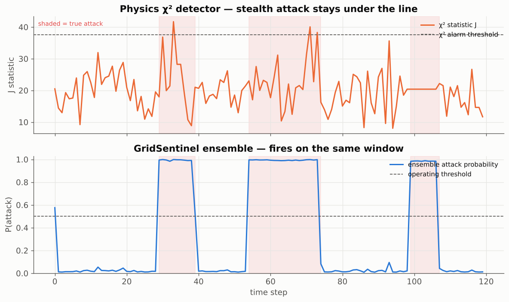
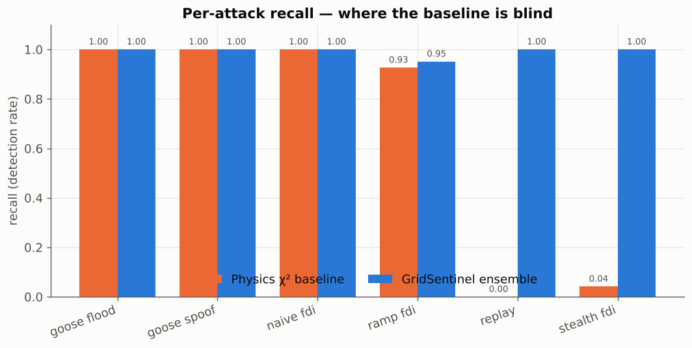
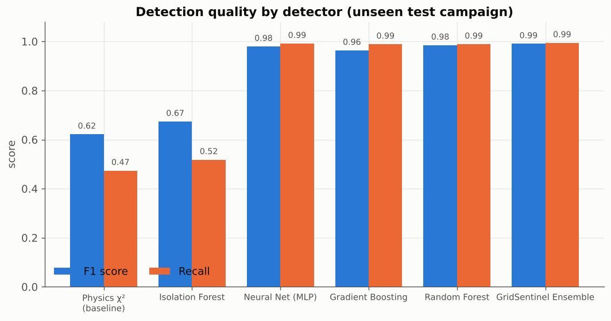
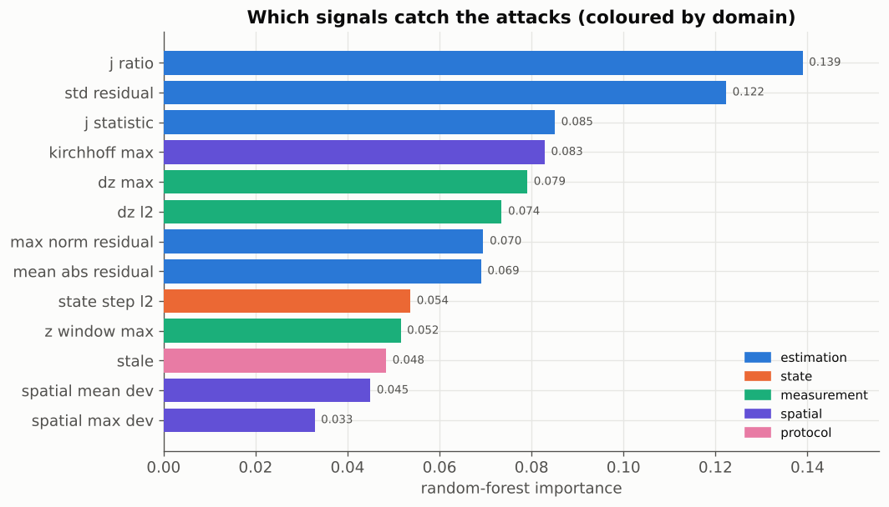
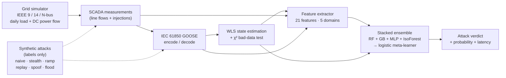

<div align="center">

# ⚡ GridSentinel

### Machine-learning detection of **False Data Injection** in smart-grid substations

*Catch the attacker feeding fake sensor readings to the power grid — including the stealthy kind the classic alarms can't see.*

[](LICENSE)
[](https://www.python.org/)
[](tests/)
[](ETHICS.md)
[](https://scikit-learn.org/)

**Ensemble recall `99%` · false-alarm rate `0.3%` · ROC-AUC `0.999`**
— vs. a classical χ² detector that catches only **47%** and is *completely blind* to stealth attacks.

</div>

> 🔒 **Defensive & fully synthetic.** Every grid, measurement and attack lives inside a software
> simulation built on standard IEEE test systems. GridSentinel never connects to, probes, or
> transmits to any real device or network. The attack generators exist **only** to create labelled
> data for training the detector. See [`ETHICS.md`](ETHICS.md).

---

## The one picture that explains everything



A nation-state attacker doesn't send *obviously* wrong data — they craft a **residue-preserving**
injection that keeps the grid's equations perfectly consistent. The classical χ² bad-data detector
(top) never crosses its alarm line. GridSentinel (bottom) fires on every attacked window, because
the fake data forces an abnormal, instantaneous jump in the *estimated grid state* that no amount of
math-consistency can hide.

---

## Why this matters

Power grids are steered by **state estimation**: thousands of sensor readings are fused into a
best-guess of the grid's true condition, and automated controls act on that guess. In 2009, Liu,
Ning & Reiter showed that an attacker who knows the grid topology can inject false measurements that
are **mathematically invisible** to the standard bad-data detector — potentially tricking operators
into dangerous actions (over/under-loading, false trips, masked faults). Real attacks on grid
infrastructure (Ukraine 2015/2016) have made this threat concrete.

GridSentinel is a research/education toolkit that shows how **machine learning across multiple
signal domains** closes that gap.

---

## Headline results

*IEEE 14-bus system · 33 meters · 13 states · 21 engineered features · unseen test campaign · trains in ~24 s on a laptop CPU.*

| Detector | Precision | Recall | **F1** | False-alarm rate | ROC-AUC |
|---|---|---|---|---|---|
| Physics χ² (baseline) | 0.905 | 0.474 | 0.622 | 1.1% | 0.734 |
| Isolation Forest | 0.964 | 0.518 | 0.674 | 0.4% | 0.939 |
| Neural Net (MLP) | 0.968 | 0.992 | 0.979 | 0.7% | 0.997 |
| Gradient Boosting | 0.939 | 0.989 | 0.964 | 1.4% | 0.999 |
| Random Forest | 0.981 | 0.989 | 0.985 | 0.4% | 0.997 |
| **GridSentinel Ensemble** | **0.986** | **0.994** | **0.990** | **0.3%** | **0.999** |

### Per-attack recall — where the baseline is blind

| Attack family | What it does | Physics χ² | **GridSentinel** |
|---|---|:---:|:---:|
| `naive_fdi` | crude meter tampering | 1.00 | **1.00** |
| `stealth_fdi` | residue-preserving injection (`a = Hc`) | 🔴 **0.04** | ✅ **1.00** |
| `ramp_fdi` | slow bias to dodge rate alarms | 0.93 | **0.95** |
| `replay` | re-send stale GOOSE frames | 🔴 **0.00** | ✅ **1.00** |
| `goose_spoof` | spoof analog values, valid control fields | 1.00 | **1.00** |
| `goose_flood` | high-rate burst, jumping `sqNum` | 1.00 | **1.00** |

> The ensemble detected **100% of attack windows** with a **median latency of 0 steps** — it catches
> the attack on the very first tampered sample.

<table>
<tr>
<td></td>
<td></td>
</tr>
<tr>
<td></td>
<td></td>
</tr>
</table>

📄 **A full, self-contained HTML report** (all figures embedded) regenerates at
[`results/report.html`](results/report.html) — open it in any browser or host it free on GitHub Pages.

---

## How it works



**The five feature domains** (so no single attack family can evade all of them):

- **Estimation** — the χ² statistic and residual shape *(catches naive FDI)*.
- **State dynamics** — how far/fast the estimated state jumped *(catches stealth FDI the χ² test can't)*.
- **Measurement** — windowed z-scores and step changes of the raw meters.
- **Spatial** — Kirchhoff and neighbour-consistency checks *(localises the anomaly in the grid)*.
- **Protocol** — GOOSE `stNum` / `sqNum` / timing anomalies *(catches replay and floods)*.

### The stealth attack, in one equation

The classical detector flags a measurement set when the weighted residual is large:

```
J = (z − H·x̂)ᵀ W (z − H·x̂)   >   χ²(α, m−n)   ⇒   ALARM
```

An attacker who injects `a = H·c` (for any state shift `c`) leaves `J` **exactly unchanged** — the
alarm never fires — while silently moving the estimated state by `c`. GridSentinel catches it
because that silent state shift is *abnormal over time*, and the temporal/state features see it.

---

## Features

- 🔌 **Real grid physics** — IEEE 9-/14-bus systems (plus a procedural `synth:<n>` generator), DC
  power flow, WLS state estimation and the textbook χ² bad-data detector.
- 📡 **IEC 61850 GOOSE** — a faithful ASN.1/BER message model with encode/decode and **Wireshark-openable
  `.pcap` export**.
- ⚔️ **Six synthetic attack families** with ground-truth labels, including the residue-preserving
  stealth attack and GOOSE replay/spoof/flood.
- 🧠 **Stacked ML ensemble** — random forest, gradient boosting, neural net and isolation forest fused
  by a logistic meta-learner, with out-of-fold training to prevent leakage.
- 📊 **Rich evaluation** — precision/recall/F1, ROC/PR curves, per-attack recall, detection latency,
  confusion matrices, feature importance, and a grid-size **scaling study**.
- 🖥️ **Three ways to run it** — a `rich` CLI, a **Streamlit dashboard**, and a **Google Colab notebook**.
- 🧪 **22 passing tests** and CI across Python 3.9–3.12.
- 💸 **Zero cost** — pure CPU, standard scientific Python, free hosting on GitHub Pages / Streamlit Cloud / Colab.

---

## Quickstart

```bash
git clone https://github.com/Lohit-18/GridSentinel.git
cd GridSentinel
python -m venv .venv && source .venv/bin/activate      # Windows: .venv\Scripts\activate
pip install -e ".[dashboard]"

# run the whole experiment → prints a table, writes figures + an HTML report
gridsentinel demo
```

More commands:

```bash
gridsentinel info                       # list grid systems and attack families
gridsentinel evaluate --system ieee14   # train + evaluate, print the comparison table
gridsentinel scaling                    # sweep ieee9 → ieee14 → synth:30 → synth:57
gridsentinel simulate --out results     # export a labelled CSV + a GOOSE .pcap
gridsentinel demo --scaling             # full demo + scaling table in the report
```

Or straight from Python:

```python
from gridsentinel.eval.experiments import run_experiment
result = run_experiment("ieee14")
print(result.headline())
```

### Live dashboard

```bash
streamlit run dashboard/app.py
```

Interactively change the grid, attack intensity and noise, and watch detection update in real time.
Deploy it **free** on [Streamlit Community Cloud](https://share.streamlit.io).

### Google Colab

Open [`notebooks/GridSentinel_Colab.ipynb`](notebooks/GridSentinel_Colab.ipynb) in Colab and
**Runtime → Run all**. Trains and renders every figure on the free CPU tier in ~2 minutes.

---

## Project structure

```
GridSentinel/
├── src/gridsentinel/
│   ├── grid/          # IEEE systems, DC power flow, WLS state estimation + χ²
│   ├── protocol/      # IEC 61850 GOOSE model, encode/decode, pcap export
│   ├── attacks/       # synthetic FDI + GOOSE attacks (labels only)
│   ├── features/      # 21-feature, 5-domain extractor
│   ├── detect/        # physics baseline + stacked ML ensemble + pipeline
│   ├── eval/          # metrics, experiments, scaling study
│   ├── report/        # self-contained HTML report
│   ├── viz/           # matplotlib figures
│   └── cli.py         # rich command-line interface
├── dashboard/app.py   # Streamlit dashboard
├── notebooks/         # Colab notebook
├── examples/          # quickstart script
├── tests/             # pytest suite (22 tests)
├── results/           # generated figures, report.html, results.json
└── .github/           # CI + issue/PR templates
```

---

## Tech stack

`Python` · `NumPy` · `SciPy` · `scikit-learn` · `pandas` · `Matplotlib` · `rich` · `Streamlit` ·
`Plotly` — all free and open source. No GPU, no paid API, no cloud account required.

## Roadmap

- [ ] AC (nonlinear) state estimation in addition to the DC model
- [ ] Graph-neural-network detector that uses the grid topology directly
- [ ] Online/streaming detection with concept-drift handling
- [ ] Import real PMU/SCADA datasets where openly licensed
- [ ] Adaptive-attacker evaluation (attacks that try to learn the detector)

## Citing

If you use GridSentinel, please cite it via [`CITATION.cff`](CITATION.cff).

## License

[Apache 2.0](LICENSE). Free for academic and commercial use with attribution.

## Acknowledgements

Built on the classical state-estimation security literature (Liu, Ning & Reiter, 2009, *False data
injection attacks against state estimation in electric power grids*) and the IEC 61850 substation
automation standard. This is a research and education project — **not** a certified protection relay.

---

<div align="center">
<sub>Made for learning how to <b>defend</b> critical infrastructure. Use it responsibly — see <a href="ETHICS.md">ETHICS.md</a>.</sub>
</div>
